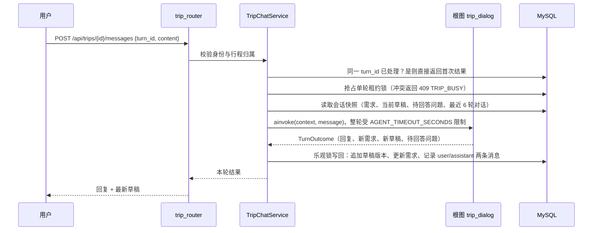
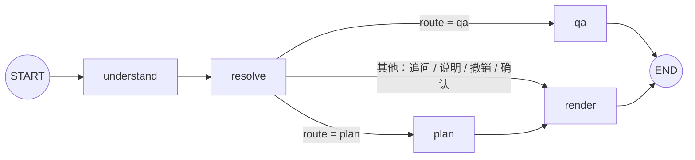
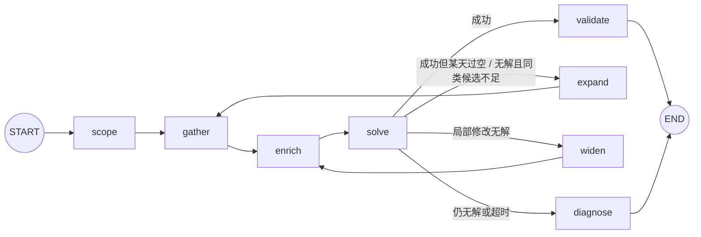

# Trip Agents 后端

Python 3.12+，使用 FastAPI、SQLAlchemy、Pydantic Settings、Loguru，已实现注册、登录、令牌校验及退出撤销，以及基于 LangGraph + OR-Tools 的单城市多轮景点行程规划 Agent（高德地图、DeepSeek，可选博查搜索）。

**在线体验：<https://kk-proj.top/>**

## 功能概览

- **对话式需求收集**：用自然语言告诉 Agent 城市、日期、天数、偏好（喜欢/不喜欢的景点类型）、节奏（休闲/适中/紧凑）和必去景点，缺什么问什么。
- **自动生成多日行程**：从高德检索候选景点，模型补全景点属性，CP-SAT 一次完成选点、分天、排序、定时和午餐安排，并结合天气预报尽量把户外景点避开雨天。
- **局部修改**：删除、替换（“把第二天的寺庙换成一个博物馆”）、新增、移动、交换、调整游玩时长、某天轻松/充实一点，只重排受影响的天；支持撤销。
- **资料问答**：询问景点开放时间、门票、交通等，由带工具的问答 Agent 查询高德和网页后回答。
- **版本与确认**：每次修改生成一个草稿版本，确认后行程只读。
- 只推荐景点，不推荐住宿和餐饮；目前只支持单城市、1～7 天。

## 整体架构

```text
浏览器（Vue 3 前端）
   │  HTTPS
   ▼
Nginx ──/api──▶ FastAPI（本项目）
                  │
                  ├─ api/        路由、鉴权依赖、异常映射
                  ├─ services/   会话租约锁、幂等、超时、乐观锁写回
                  ├─ agent/      LangGraph 根图 + 规划子图 + CP-SAT 求解器
                  ├─ tools/      高德 / 博查客户端、问答工具
                  └─ repository/ ──▶ MySQL（行程、草稿版本、对话、景点属性缓存）
                  │
                  ├──▶ DeepSeek（意图理解、景点属性补全、资料问答）
                  ├──▶ 高德 Web 服务（地点搜索、名称核实、天气预报）
                  └──▶ 博查（可选，网页搜索）
```

一次对话的处理流程：



每条用户消息是一次完整的图执行，不使用 checkpointer 和 interrupt：MySQL 是会话状态的唯一事实来源，待回答问题作为数据保存，用户下一条消息按普通输入处理（详见 [行程 Agent 文档](docs/trip_agent.md#为什么不用-checkpointer-和-interrupt)）。

## Agent 与图结构

### 根图 `trip_dialog`

代码：`app/agent/trip/trip_graph.py`、`trip_nodes.py`、`trip_edges.py`，单轮步骤上限 20。



| 节点 | 作用 | 是否调用模型 |
| --- | --- | --- |
| `understand` | 规则快速路径（选项序号、撤销、确认等）优先；其余用 DeepSeek 结构化输出得到 `TurnIntent` | 快速路径不调用 |
| `resolve` | `IntentResolver` 把意图落到需求与修改操作上，用高德核实景点名称，名称有歧义时生成选项；决定路由 | 否（调用高德） |
| `plan` | 调用规划子图，得到新草稿或失败诊断 | 子图内的 `enrich` 会调用 |
| `qa` | 资料问答 Agent，直接生成回复 | 是 |
| `render` | 生成回复文字：变化摘要、补位说明、追问 | 否 |

### 规划子图 `trip_planning`

代码：`app/agent/trip/planning/`，步骤上限 40（最长路径约 17 步：两轮扩搜、两级放宽）。



| 节点 | 作用 |
| --- | --- |
| `scope` | 判断全量规划还是局部修改，确定受影响的天、必选/保留/替换约束 |
| `gather` | 用固定模板（`城市+热门景点/必去景点/旅游景点` 及偏好关键词）并行搜索高德，同时获取天气预报 |
| `enrich` | 过滤、去重、合并父子景区，确定 ≤ 35 个候选；补全景点属性（先查 `poi_profiles` 缓存，缺失的批量调用模型，失败按规则推断）并打分 |
| `solve` | OR-Tools CP-SAT 两阶段求解（见下文目标函数），在线程中执行 |
| `expand` | 候选不足时追加模板（景点推荐、好玩的地方、公园、博物馆）多搜一轮，最多 2 轮 |
| `widen` | 局部求解无解时逐级放宽：固定原景点 → 原景点软保留 → 纳入相邻天 |
| `validate` | 独立于求解器重新验算草稿（时间窗、交通、午餐、约束） |
| `diagnose` | 给出失败原因和可选操作，例如询问是否允许调整其他天 |

> 搜索与天气在 `gather` 节点内用 `asyncio.gather` 并行，而不是拆成并行分支：图中存在回环，并行分支的汇合等待在第二轮会卡住。

### 用到的 LLM 能力

| 名称 | 位置 | 形式 | 说明 |
| --- | --- | --- | --- |
| 意图理解 | `understand` 节点，提示词 `app/prompt/trip_understand_prompt.py` | DeepSeek 结构化输出 → `TurnIntent` | 输出解析失败视为没听懂，请用户换个说法；离线评估见 [意图评估文档](docs/intent_eval.md) |
| 景点属性补全 | `enrich` 节点，提示词 `app/prompt/poi_enrich_prompt.py` | 结构化输出，每批 25 个、并发 3 | 细分体验类型、室内外、建议游玩分钟数；结果全局缓存在 `poi_profiles` |
| 资料问答 Agent | `qa` 节点，提示词 `app/prompt/trip_qa_prompt.py` | `langchain.agents.create_agent` 工具调用 Agent | 工具：`lookup_place`（高德地点查询）、`get_current_plan`（读取当前草稿）、`web_search`（配置博查密钥时启用）；`ToolCallLimitMiddleware` 与 `ModelCallLimitMiddleware` 限制工具与模型调用次数 |

兴趣打分、选点和排程都不交给模型，而是用确定性规则 + 求解器完成，保证同样输入得到同样结果、结果可解释。

## 求解的目标函数

CP-SAT 模型只包含待求解的天（局部修改时固定天不进入模型）。决策变量：

- $x_{ik}\in\{0,1\}$：景点 $i$ 是否安排在第 $k$ 天；
- $y_{ijk}\in\{0,1\}$：第 $k$ 天是否从景点 $i$ 直接前往景点 $j$（每天一条开放路径，`AddCircuit` 建模）；
- $s_i, e_i$：开始/结束分钟（相对 9:00），以及午餐位置变量。

### 第一阶段：最大化收益

$$
\max\;
\sum_{i,k} v_i\,x_{ik}
\;-\;2\sum_{k,c}\max\!\left(n_{kc}-1,\,0\right)
\;-\;3\sum_{t}\max\!\left(n_t-2,\,0\right)
\;-\;3\sum_{i,k} r_{ik}\,x_{ik}
\;+\;8\sum_{(i,k)\in K} x_{ik}
\;-\;\frac{1}{15}\sum_{i,j,k} d_{ij}\,y_{ijk}
$$

| 符号 | 含义 |
| --- | --- |
| $v_i = I_i + R_i + T_i + 6$ | 单点收益，6 为每个入选景点的基础奖励（鼓励在约束内多安排） |
| $I_i$ | 兴趣分：景点标签 × 用户偏好。未设偏好 5；命中“喜欢” 7、“非常喜欢” 10；有喜欢偏好但未命中 2；命中“不喜欢”且未命中任何喜欢 0（只设置了不喜欢时，其余景点按中性 5） |
| $R_i$ | 评分质量分：高德评分 × 2（上限 10），缺失时取候选评分中位数 × 2，都缺失时取 7 |
| $T_i$ | 热度奖励：$\min(3,\ 1.5\times\max(0,h_i-1)) + \mathbb{1}[\text{命中“必去景点”模板}]$，$h_i$ 为命中的搜索模板数 |
| $n_{kc}$ | 第 $k$ 天主体验类 $c$ 的景点数，每天同类第 2 个起每个罚 2 |
| $n_t$ | 全程细分体验 $t$ 的景点数（含固定天已占用），第 3 个起每个罚 3 |
| $r_{ik}$ | 雨天惩罚单位：室内 0；户外 = 降雨等级(0～3) × 时长档；半室内 = 降雨等级 × max(1, 时长档 // 2)；时长档 ≤ 90 分钟为 1、≤ 180 分钟为 2、更长为 3 |
| $K$ | 局部修改时需要“软保留”的原景点及其原日期，保留一个奖励 8 |
| $d_{ij}$ | $i\to j$ 的交通分钟数，每 15 分钟交通抵消 1 分收益 |

实现上为了让 CP-SAT 只处理整数，代码中的实际目标是上式整体乘以 `score_scale × travel_divisor = 10 × 15 = 150`：

```text
maximize 15·Σ round(10·v_i)·x_ik − 150·(惩罚 − 保留奖励) − 10·Σ d_ij·y_ijk
```

权重集中定义在 `app/schemas/trip_plan_schema.py` 的 `ObjectiveWeights`，求解结果中的 `objective` 字段会按项拆分（`value`、`travel_minutes`、`day_category_penalty`、`subtype_penalty`、`rain_penalty`、`keep_bonus`）便于解释与调参。

### 第二阶段：压缩时间

固定第一阶段的入选、分天和路径（目标值不变），再求

$$
\min \sum_i s_i
$$

使每天的行程尽量从 9:00 开始、紧凑排列；午餐位置不影响收益，在本阶段可重新选择。

### 主要约束

- 每个景点至多安排一次；每天景点数不超过节奏上限（休闲 3、适中 4、紧凑 5，“轻松/充实一点”±1）。
- 每天时间窗 9:00–19:00（休闲 17:30 前结束，“轻松一点”再提前 90 分钟）；$s_j \ge e_i + d_{ij}$（若在 $i$ 之后吃午餐再加 60 分钟）。
- 午餐 1 小时：上午开始且下午结束的天必须安排一次午餐，在 11:30–12:30 之间开始；游玩 ≥ 3 小时的景点可以在景点内用餐。
- 必去景点必须入选（指定日期时固定到该天）；替换约束要求该天至少选入指定数量的满足标签的新景点。
- 单段交通超过 120 分钟视为不可达；交通按直线距离估算步行/打车时间（规则见 [行程 Agent 文档](docs/trip_agent.md#规划规则)）。

### 求解策略

- 候选数超过 20 时先做近邻裁剪：每个景点只保留交通最近的 10 条出边（必选/替换/保留景点之间的边全部保留）；裁剪模型无解再用完整边在剩余时间内重解，因此裁剪不会改变可行性判断。
- 固定随机种子、8 个搜索线程；第二阶段限时为第一阶段的 1/3（不少于 1 秒）。
- 求解无解或超时由子图路由到 `expand` / `widen` / `diagnose` 处理。

## 本地运行

以下命令在后端项目根目录执行：

```powershell
uv sync --locked
# 仅在 .env 不存在时复制；初始化已生成一份本地 .env。
if (-not (Test-Path .env)) { Copy-Item .env.example .env }
# 编辑 .env，配置 MySQL 和 AUTH_JWT_SECRET；行程对话需要 AMAP_API_KEY 和 DEEPSEEK_API_KEY，BOCHA_API_KEY 可选。
# 首次部署执行 scripts/trip_agents.sql 建表。
uv run --no-sync python main.py
```

默认监听 `http://127.0.0.1:8000`，接口文档位于 `/docs`。开发自动重载需要同时设置 `APP_ENV=development` 和 `APP_DEBUG=true`。也可以运行 `uv run --no-sync uvicorn main:app`，监听参数使用 Uvicorn CLI 选项。

## 部署

线上环境（<https://kk-proj.top/>）使用仓库根目录的 `docker-compose.yml`，由三个服务组成：

| 服务 | 说明 |
| --- | --- |
| `mysql` | MySQL 8.0，首次启动（数据卷为空）时自动执行 `backend/scripts/trip_agents.sql` 建表；不对外暴露端口 |
| `backend` | 本项目镜像（`backend/Dockerfile`），密钥从 `backend/.env` 注入，容器内覆盖为生产配置；`AGENT_TIMEOUT_SECONDS=90`，低于 Cloudflare 免费版 100 秒的代理超时 |
| `nginx` | 前端静态资源 + 反向代理 `/api`，监听 80/443，证书挂载自 `nginx/certs` |

```bash
# 在仓库根目录，先在 .env 中设置 MYSQL_ROOT_PASSWORD、MYSQL_PASSWORD，并准备好 backend/.env
docker compose up -d --build
```

## 目录职责

```text
app/
  api/          # 路由与请求依赖
  services/     # 业务规则与事务协调
  repository/   # 数据读写
  models/       # 统一 Base、用户与令牌撤销表映射
  schemas/      # 请求、响应和业务传输模型
  core/         # 配置、日志、数据库引擎、认证基础能力及业务异常
  agent/        # 图、状态、节点、边与钩子；trip/ 为行程根图，trip/planning/ 为规划子图与求解器
  prompt/       # 提示词函数
  tools/        # 高德、博查客户端与问答 Agent 工具
tests/
  core/         # 配置、日志与应用生命周期测试
  auth/         # 认证 schema、HTTP 契约、故障及并发测试
  trip/         # 行程规划：求解器、候选集、校验、意图解析、图与 HTTP 契约测试
  integration/  # 真实服务集成测试，默认不执行
  evals/        # 评估框架自身的单测（假模型）
evals/          # Agent 离线评估：intent/ 为意图理解评估集、运行器与判分
scripts/        # 已有数据库维护脚本
docs/           # 项目文档
main.py         # FastAPI 应用与生命周期
```

规划子图内部模块：

| 文件 | 职责 |
| --- | --- |
| `scope.py` | 修改范围、受影响的天、放宽级别 |
| `tags.py` | 体验类型与标签匹配 |
| `scoring.py` | 兴趣分、评分分、热度奖励，转换为求解器输入 |
| `travel.py` | 直线距离估算步行/打车时间与费用 |
| `rules.py` | 午餐、节奏、雨天惩罚等规则常量 |
| `solver.py` | CP-SAT 建模与两阶段求解 |
| `assemble.py` | 求解结果组装为草稿、生成变化摘要 |
| `validate.py` | 草稿独立验算 |

## 文档

- [配置文档](docs/configuration.md)：配置项与日志用法
- [认证文档](docs/authentication.md)：接口、安全边界及 MySQL 集成验证
- [行程 Agent 文档](docs/trip_agent.md)：接口、生命周期、图结构、候选与规划规则、前端字段
- [意图评估文档](docs/intent_eval.md)：意图理解离线评估

真实 `.env`、日志和本地产物已加入 Git 忽略规则。

## 验证

```powershell
uv run --no-sync pytest -q
uv run --no-sync python -m compileall -q app main.py tests
```

意图理解的离线评估（调用真实 DeepSeek）见 [意图评估文档](docs/intent_eval.md)：`uv run --no-sync python -m evals.intent run`。

默认测试使用临时文件 SQLite 和可控输入，无需真实 MySQL、地图或模型服务。真实 MySQL 及真实 DeepSeek + 高德端到端验证需设置 `RUN_TRIP_INTEGRATION=1` 后单独运行。项目尚未配置独立的 lint/类型检查工具；上述 `compileall` 仅验证语法。
